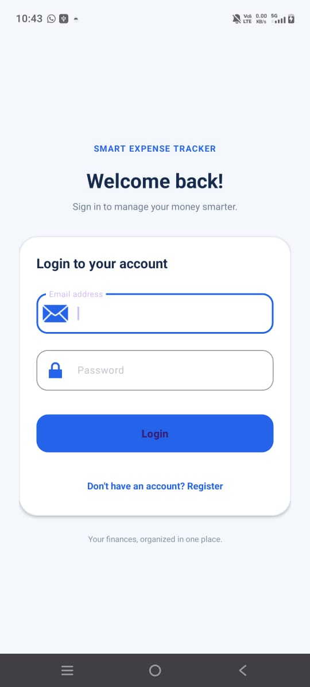
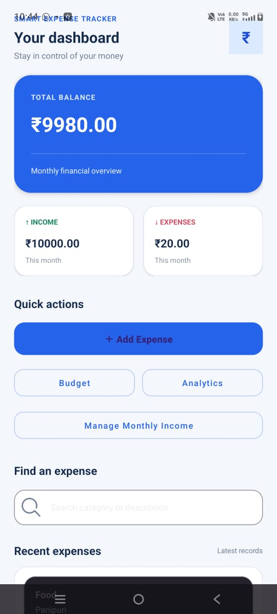
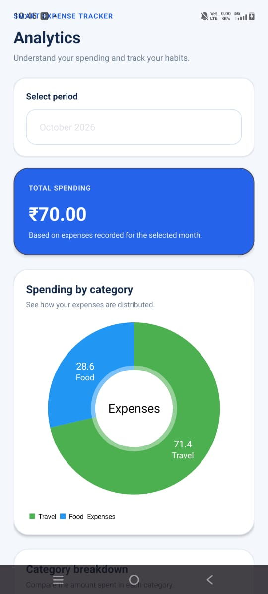
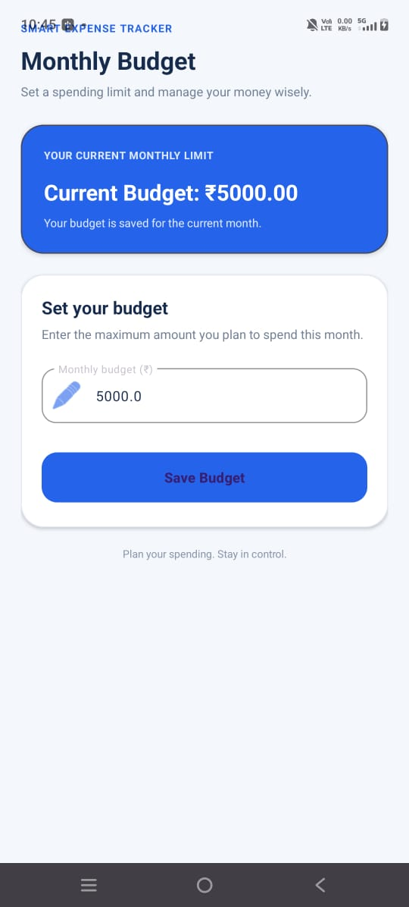
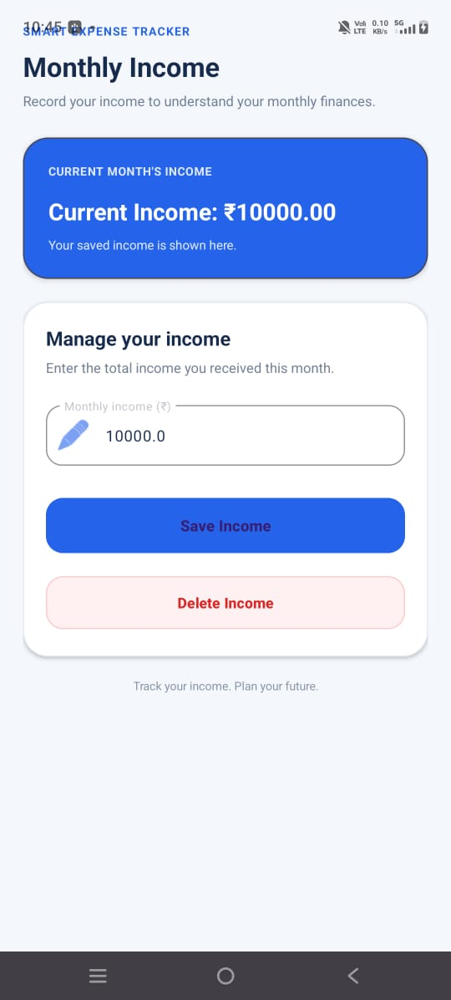
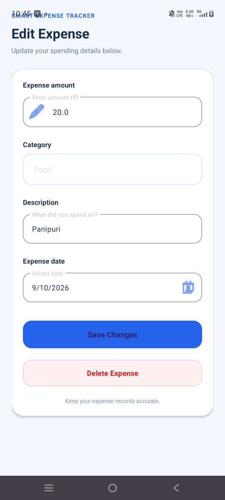

# Smart Expense & Budget Tracker

An Android application developed using Java and XML to help users manage expenses, income, and monthly budgets.

## Features
- User registration and login
- Add, edit, and delete expenses
- Expense categories and monthly analytics
- Income tracking
- Monthly budget management
- Budget progress and spending insights
- Expense data storage using Room Database
- Firebase Authentication
- Daily expense reminders

## Technologies Used
- Java
- XML
- Android Studio
- Room Database
- MVVM Architecture
- Firebase Authentication
- Retrofit and REST APIs
- MPAndroidChart
- WorkManager
## App Screenshots

### Login

### Dashboard

### Add Expense

### Analytics

### Monthly Budget

### Monthly Income

### Edit Expense

## Developer
Lalitha A
